<p align="center">
  
</p>

<h1 align="center">EduAI Platform · 智慧教育平台</h1>

<p align="center">选课、上课、做题、投简历，放在同一个网站里的 AI 学习平台</p>

<p align="center">
  <a href="https://github.com/FreeNAP/edu-ai-platform"></a>
  <a href="LICENSE"></a>
  <a href="https://vuejs.org/"></a>
  <a href="https://fastapi.tiangolo.com/"></a>
  <a href="https://www.python.org/"></a>
  <a href="#测试"></a>
</p>

<p align="center">
  <a href="#快速开始">快速开始</a> ·
  <a href="docs/01-项目需求分析（PRD）.md">需求文档</a> ·
  <a href="docs/02-系统架构设计.md">架构设计</a> ·
  <a href="docs/API契约.md">接口文档</a> ·
  <a href="#页面展示">页面展示</a>
</p>

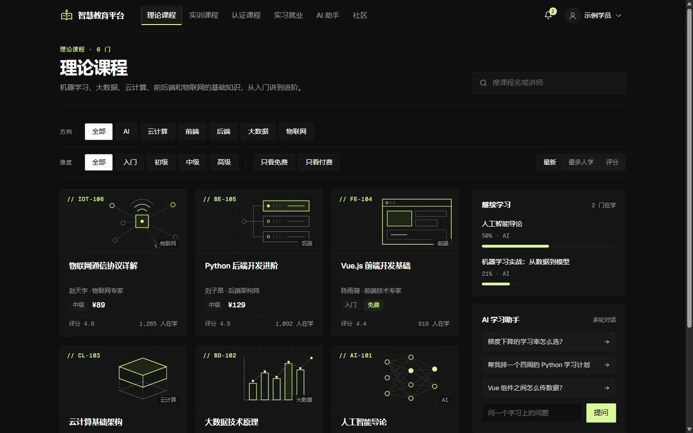

EduAI Platform 是一个前后端分离的在线学习平台。学生在**理论课程、实训课程、认证课程、实习就业**四个模块之间切换：按方向和难度找课、逐课时学习并自动记录进度、遇到问题问 AI 助手、投递实习岗位前先做一场 AI 模拟面试。管理员在后台管理用户、课程目录、职位、订单、申请和社区内容。

后端是 FastAPI + SQLAlchemy，默认 SQLite 开箱即用，可切换 MySQL；AI 能力走 OpenAI 兼容接口，没有配置密钥时由内置引擎生成同结构的结果，所有页面都能完整演示。

## 核心功能

- **用户系统**：注册、登录、找回密码、修改资料与密码；学生 / 教师 / 管理员三种角色；8 个内置几何头像或自定义图片地址。
- **课程资源**：按技术方向（AI、大数据、云计算、前端、后端、物联网）、难度、是否免费组合筛选；按最新、学习人数、评分排序；课程名和讲师名模糊搜索。
- **课程学习**：课程详情含简介、章节目录、讲师、评价；报名后逐课时学习，讲义正文只对已报名用户可见；完成课时自动累计时长并更新进度。
- **订单**：付费课程生成订单，模拟支付后自动报名，个人中心可查看订单与支付时间。
- **实习就业**：按职位分类、城市筛选，岗位名 / 公司名搜索；收藏、一键投递、查看申请状态。
- **AI 学习助手**：
  - 智能答疑：多轮对话，可关联正在学的课程，会话自动保存；
  - 学习路径：输入目标方向和每周时长，生成分阶段计划并关联站内课程，计划会保存并在到期时提醒；
  - 作业批改：提交题目和代码，返回分数、做对的地方、问题、建议和改进后的代码；
  - 学习报告：按周 / 月统计学习时长、完成课时、各课程进度和薄弱点；
  - AI 模拟面试：按岗位出题，作答后给出总分和逐题点评，记录可随时回看。
- **消息通知**：收藏的课程或职位有更新、申请状态变化、订单支付成功、学习计划到期、自己的问题收到回答时自动通知。
- **问答社区**：提问、回答、搜索；作者和管理员可删除问题或回答。
- **后台管理**：数据看板（用户、课程、订单、收款、学习时长、近 7 日活跃趋势）；用户新建 / 改角色 / 禁用；课程上下架与章节目录编辑；讲师、职位、订单、职位申请、社区内容管理。
- **移动端**：全站响应式，手机上导航收进全屏菜单，后台菜单改为横向滚动，320px 宽度无横向溢出。

## 项目功能流程

所有流程图默认折叠，点击标题展开。

<details>
<summary><strong>01｜登录注册与角色分流</strong></summary>

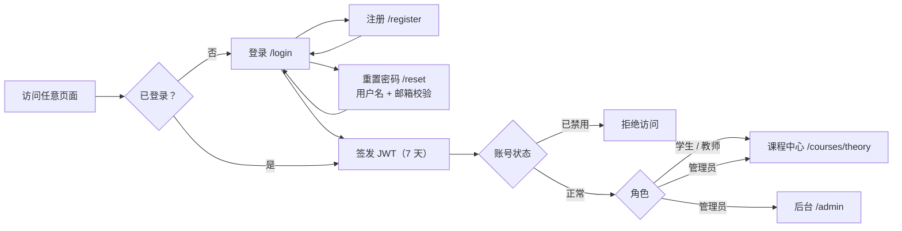

</details>

<details>
<summary><strong>02｜选课、报名与学习进度</strong></summary>

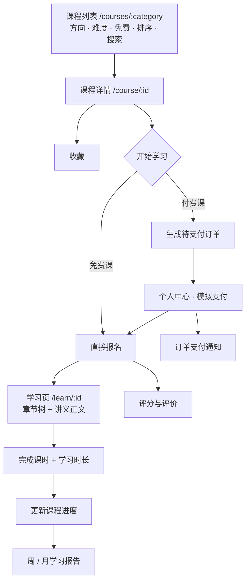

</details>

<details>
<summary><strong>03｜AI 学习助手</strong></summary>

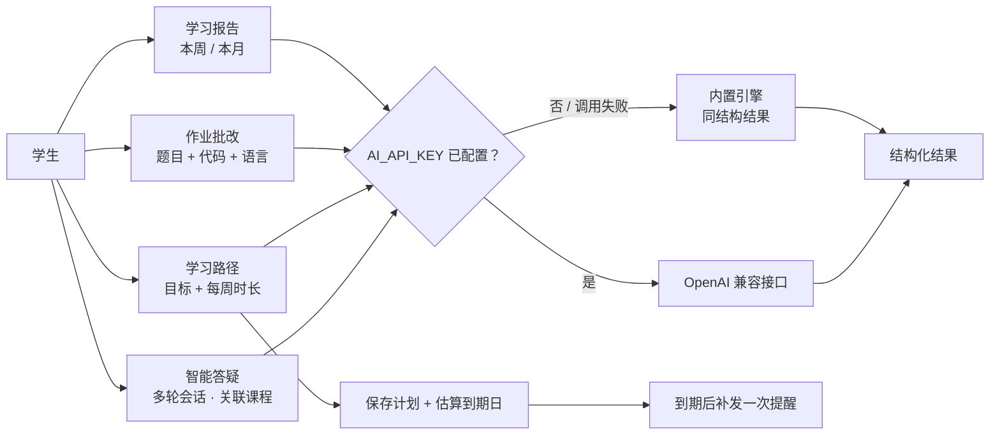

</details>

<details>
<summary><strong>04｜实习就业与 AI 模拟面试</strong></summary>

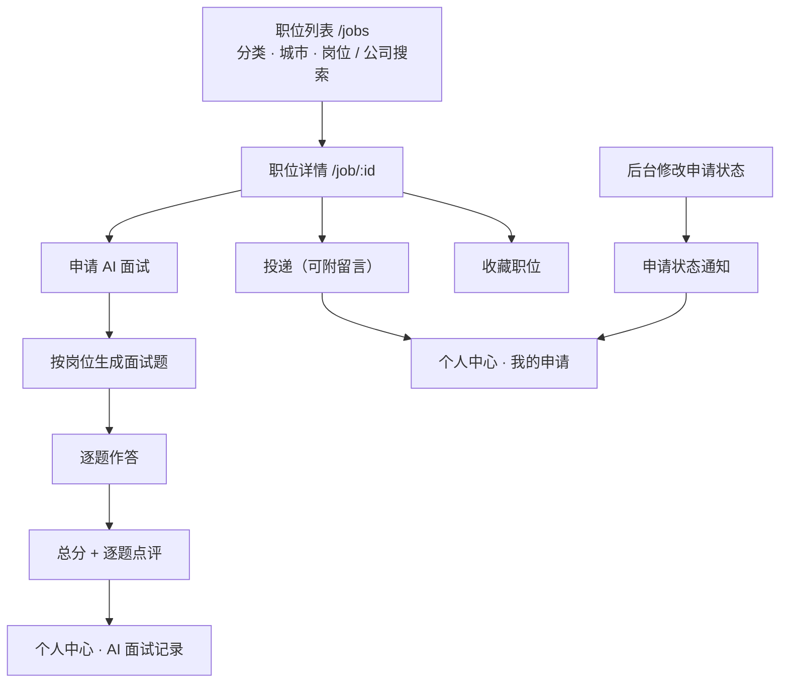

</details>

<details>
<summary><strong>05｜后台管理与自动通知</strong></summary>

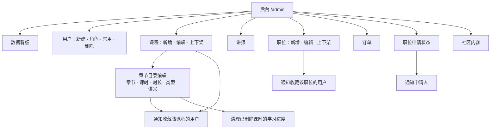

</details>

<details>
<summary><strong>06｜前后端数据流</strong></summary>

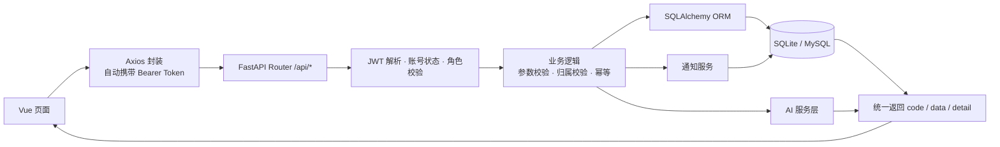

</details>

## 技术栈

| 层 | 选型 |
| --- | --- |
| 前端 | Vue 3.5、Vite 5、Element Plus 2（暗色主题）、Pinia、Vue Router、Axios、ECharts 5、Geist 字体（本地打包） |
| 后端 | Python 3.11、FastAPI、SQLAlchemy 2.0、Pydantic 2、PyJWT、Uvicorn |
| 数据库 | SQLite（默认）、MySQL（设置 `DATABASE_URL`） |
| AI | OpenAI 兼容 Chat Completions 接口（DeepSeek、通义千问、Moonshot 等），未配置时使用内置引擎 |
| 测试 | pytest + FastAPI TestClient，独立测试库 |

## 快速开始

环境要求：Python 3.11+、Node.js 20+。

### 一键启动（Windows）

```bat
:: 开发模式：后端 :8000 + 前端热更新 :5173
start-dev.bat

:: 生产模式：构建前端后由后端统一托管，访问 http://127.0.0.1:8000
start-prod.bat
```

### 手动启动

```bash
git clone https://github.com/FreeNAP/edu-ai-platform.git
cd edu-ai-platform

# 后端（首次启动自动建表并写入演示数据）
cd backend
pip install -r requirements.txt
python -m uvicorn app.main:app --host 127.0.0.1 --port 8000

# 前端（新开一个终端）
cd frontend
npm install
npm run dev          # http://localhost:5173，/api 自动代理到 8000
```

生产部署只需要构建前端，再启动后端：

```bash
cd frontend && npm run build
cd ../backend && python -m uvicorn app.main:app --host 0.0.0.0 --port 8000
```

后端检测到 `frontend/dist` 后会托管静态页面，非 `/api` 路径回退到 `index.html`，局域网内其他设备访问 `http://<本机IP>:8000` 即可。

### 演示账号

| 账号 | 密码 | 角色 | 预置数据 |
| --- | --- | --- | --- |
| `admin` | `admin123` | 管理员 | 后台全部功能 |
| `teacher` | `teacher123` | 教师 | — |
| `student` | `student123` | 学生 | 2 门在学课程、学习记录、1 个订单、1 条申请、1 场已完成的 AI 面试、1 份学习路径、通知 |

## 配置

后端通过环境变量读取配置，模板见 [`backend/.env.example`](backend/.env.example)。

| 变量 | 默认值 | 说明 |
| --- | --- | --- |
| `SECRET_KEY` | 开发用默认值 | JWT 签名密钥。仍为默认值时启动日志会给出警告，生产环境务必修改 |
| `DATABASE_URL` | `sqlite:///backend/edu_platform.db` | 换成 MySQL 时需另装驱动，例如 `pip install pymysql` |
| `AI_API_KEY` | 空 | 留空使用内置引擎 |
| `AI_BASE_URL` | `https://api.deepseek.com` | 任意 OpenAI 兼容服务地址 |
| `AI_MODEL` | `deepseek-chat` | 模型名称 |

```bash
# Windows
set AI_API_KEY=sk-xxxx
set AI_BASE_URL=https://api.deepseek.com
set AI_MODEL=deepseek-chat

# macOS / Linux
export AI_API_KEY=sk-xxxx
```

真实接口超时或返回格式不对时会自动回退到内置引擎，页面不会报错。

## 测试

```bash
cd backend
python -m pytest tests -q
```

40 个用例覆盖：注册登录与密码、课程筛选排序、报名与课时进度、订单支付、职位投递、AI 四项功能与模拟面试、学习路径到期提醒、全部自动通知规则、社区删除权限、课程目录替换与进度清理、下架内容隐藏、禁用账号拦截、越权访问、分页上限、重复操作幂等、统一错误格式。测试使用临时数据库，不影响开发数据。

## 目录与文件用途

| 路径 | 内容 |
| --- | --- |
| `backend/app/main.py` | FastAPI 入口：CORS、统一异常处理、路由注册、启动建表与演示数据、托管前端产物 |
| `backend/app/routers/` | `auth` `users` `courses` `jobs` `orders` `ai` `notifications` `community` `admin` 九组接口 |
| `backend/app/services/llm.py` | OpenAI 兼容接口调用、结果结构校验与失败回退 |
| `backend/app/services/mock_engine.py` | 内置 AI 引擎：答疑知识库、路径规划、代码批改、报告统计、面试题库 |
| `backend/app/services/notify.py` | 通知写入与学习计划到期提醒 |
| `backend/app/models.py` / `schemas.py` | 数据表模型与请求体校验 |
| `backend/app/seed.py` / `seed_content.py` | 演示账号、18 门课程、课时讲义、12 个职位与学习记录 |
| `backend/tests/` | 接口测试与公共夹具 |
| `frontend/src/views/` | 登录、课程、学习、职位、面试、AI 助手、个人中心、通知、社区、后台各页面 |
| `frontend/src/components/` | 课程卡、按方向区分的 SVG 课程封面、职位卡、头像；`icons/` 下为标志、图标与几何头像 |
| `frontend/src/api/` | 按业务拆分的接口调用 |
| `frontend/src/styles/index.css` | 设计令牌、Element Plus 暗色覆盖、通用组件与响应式规则 |
| `docs/` | 需求分析、系统架构、接口文档与截图 |
| `start-dev.bat` / `start-prod.bat` | Windows 一键启动脚本 |

## 页面展示

<table>
  <tr>
    <td width="50%"><strong>登录</strong><br>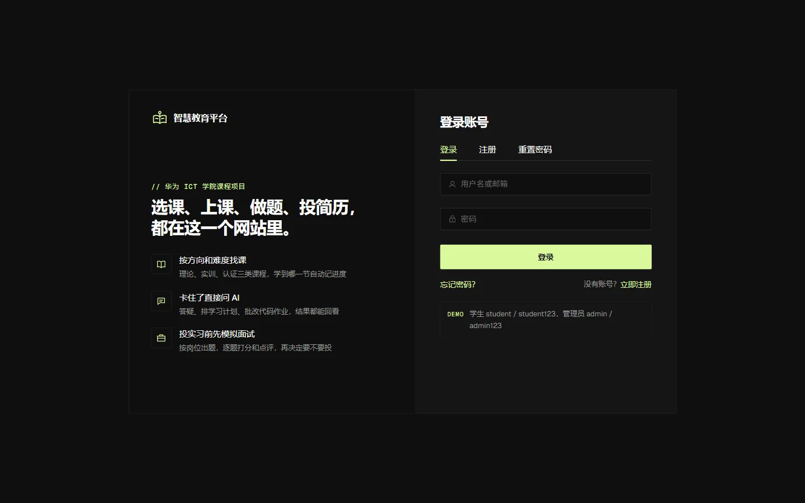</td>
    <td width="50%"><strong>课程中心</strong><br></td>
  </tr>
  <tr>
    <td><strong>课程详情</strong><br>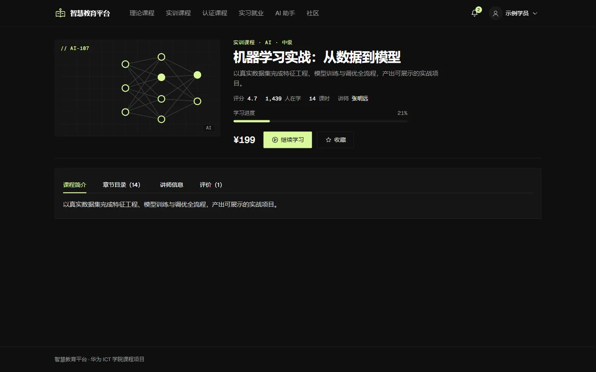</td>
    <td><strong>课时学习</strong><br>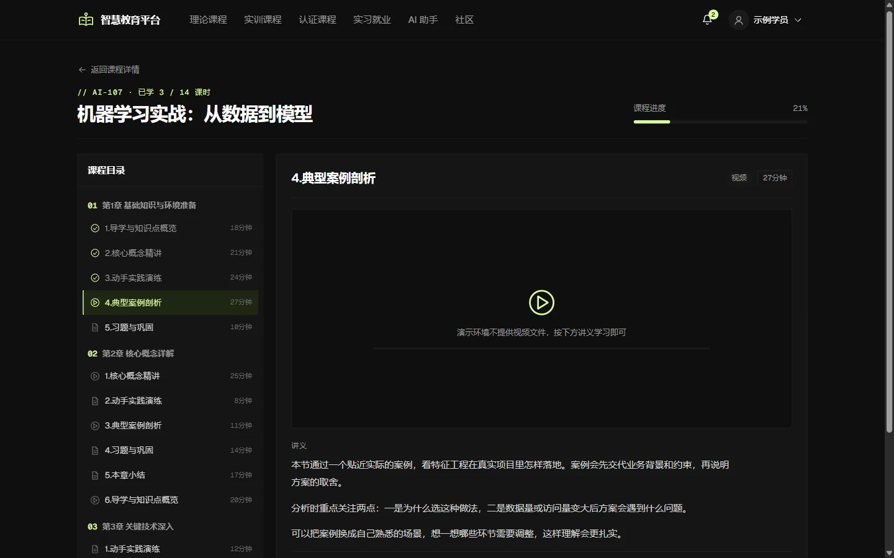</td>
  </tr>
  <tr>
    <td><strong>实习就业</strong><br>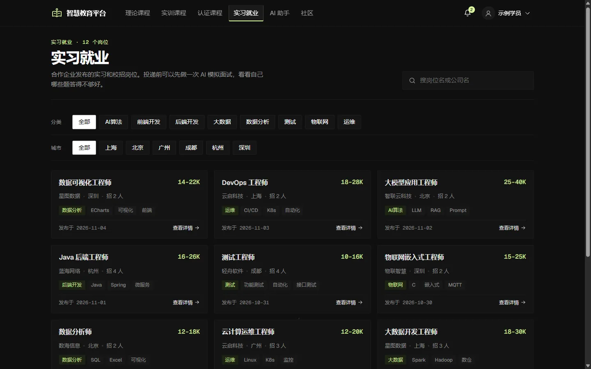</td>
    <td><strong>AI 模拟面试结果</strong><br>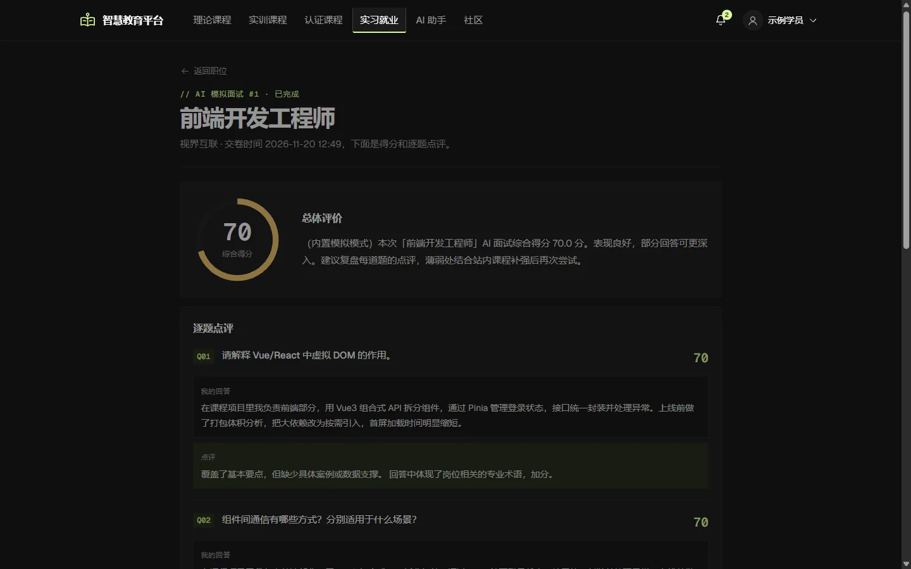</td>
  </tr>
  <tr>
    <td><strong>学习报告</strong><br>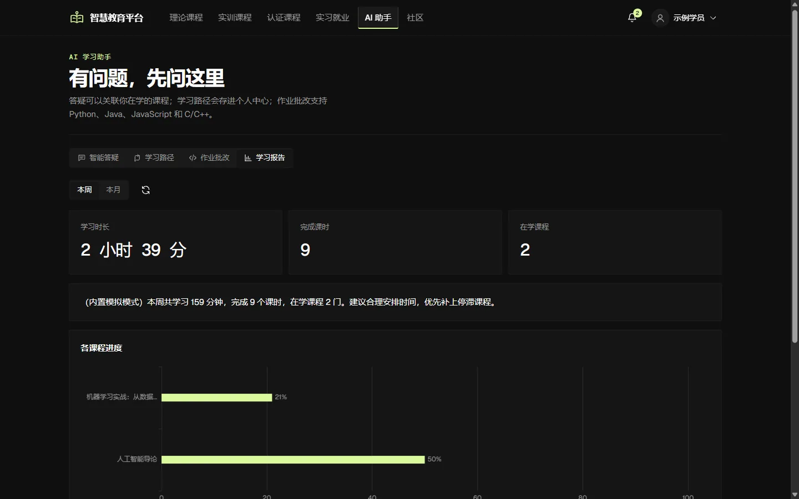</td>
    <td><strong>个人中心</strong><br>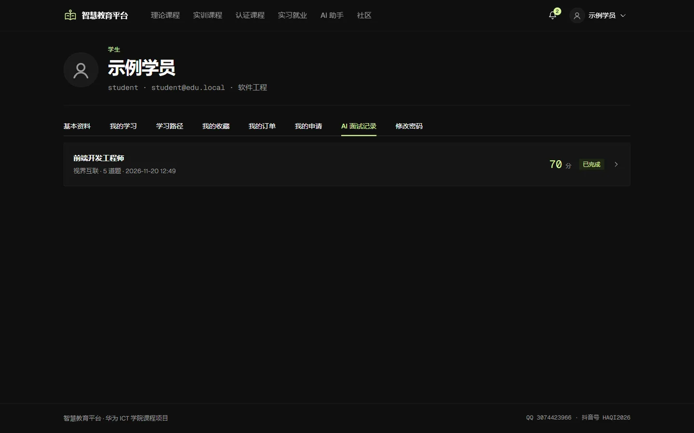</td>
  </tr>
  <tr>
    <td><strong>后台数据看板</strong><br>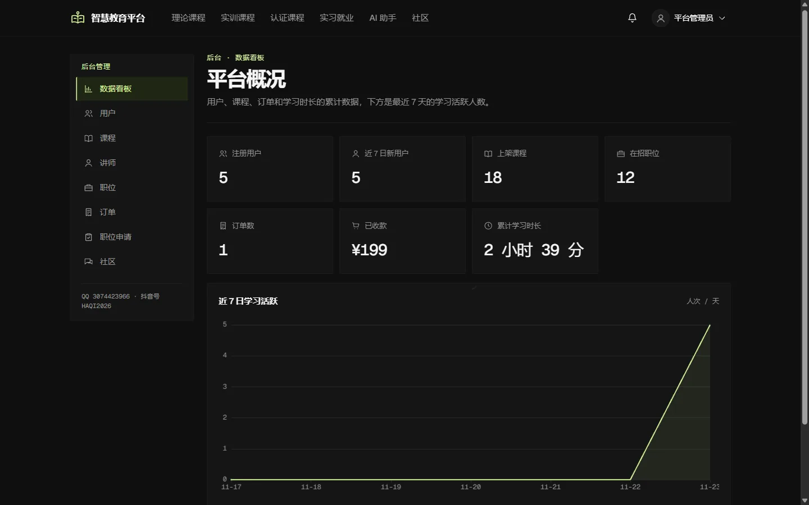</td>
    <td><strong>课程目录编辑</strong><br>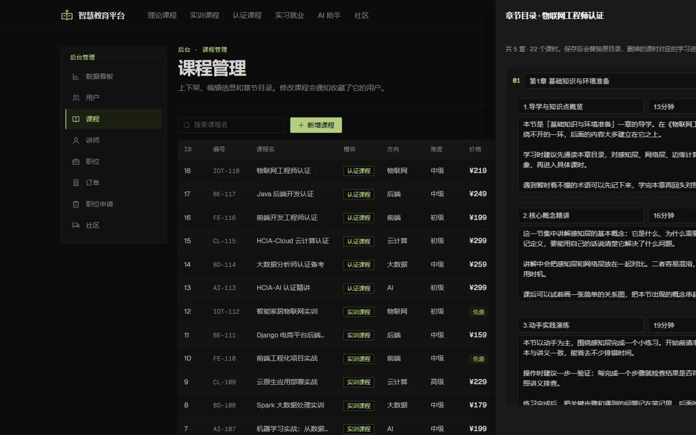</td>
  </tr>
</table>

## 作者

QQ 3074423966 · 抖音号 HAQI2026

## 许可证

[MIT](LICENSE)
